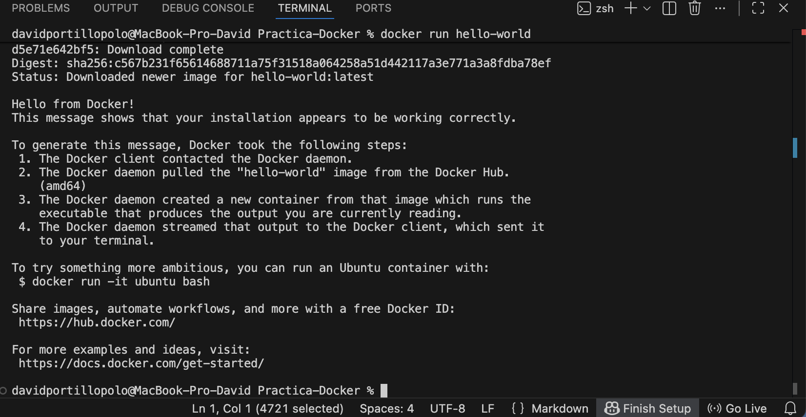
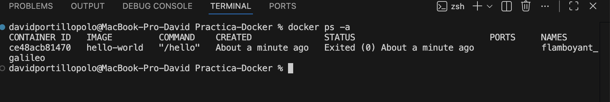
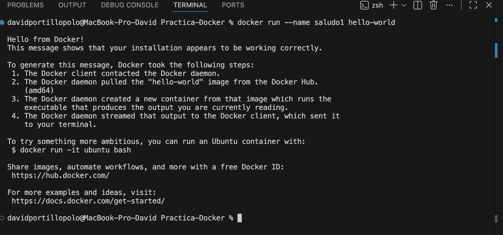
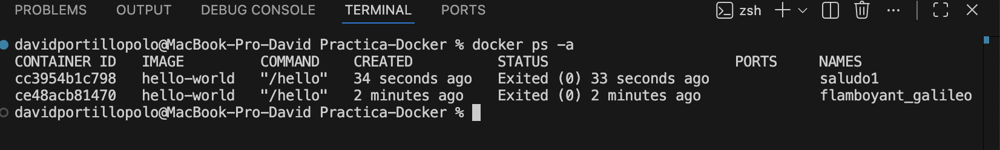
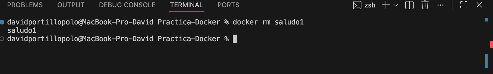
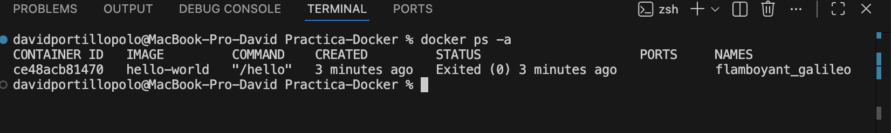
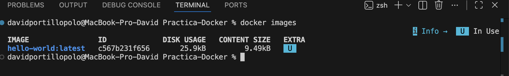
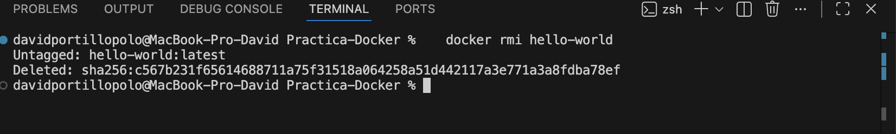
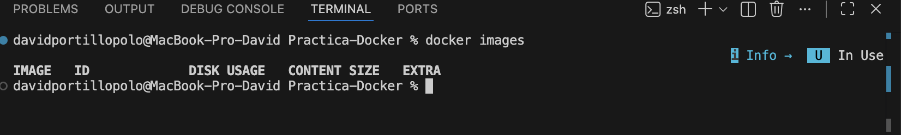

# Práctica Docker: Contenedores efímeros

**Alumno:** David Portillo Polo

**Fecha:** 9 de noviembre de 2026

## Introducción

En esta práctica hacemos nuestra primera toma de contacto con Docker. Trabajamos con contenedores efímeros, es decir, contenedores que realizan una tarea y se detienen nada más terminarla. Veremos cómo se descarga una imagen, cómo se crean y ejecutan contenedores, cómo comprobar su estado y cómo eliminar tanto los contenedores como la imagen cuando ya no los necesitamos.

En todas las capturas se ve el usuario de la terminal (`davidportillopolo`).

---

## Parte 1. Ejecutar el primer contenedor y observar su ciclo de vida

### 1.1. Ejecución y descarga

**Comando:**

```bash
docker run hello-world
```

**Explicación:** Con este comando le pedimos a Docker que cree y ejecute un contenedor a partir de la imagen `hello-world`. Si la imagen no está en nuestro equipo, Docker la descarga antes de ejecutarla.

**Captura 1:** Ejecución del comando y su resultado.



### 1.2. Reflexión: ¿qué mensaje aparece?

Al ejecutar el comando aparece el mensaje **"Hello from Docker!"**, que indica que la instalación funciona correctamente.

Las acciones que Docker reporta haber realizado son:

1. **Descargar:** como la imagen no estaba en el equipo, la descarga de Docker Hub. En la captura se ve `Download complete`, el `Digest` de la imagen y la línea `Status: Downloaded newer image for hello-world:latest`.
2. **Verificar:** Docker comprueba la imagen con su identificador único (el `Digest` sha256).
3. **Ejecutar:** crea un contenedor nuevo a partir de la imagen y ejecuta el programa que contiene, que es el que imprime el mensaje.
4. **Salir:** el programa termina y el contenedor se detiene.

**¿Dónde reside la imagen ahora? ¿Se ha eliminado?** La imagen se guarda en el almacén local de imágenes de Docker en nuestro ordenador y **no se elimina** al terminar la ejecución. Más adelante lo comprobamos con `docker images`.

**¿Sigue "vivo" o terminó?** El contenedor **terminó**. Realiza su tarea (mostrar el mensaje) y se para. Su estado final es `Exited (0)`, que significa que acabó correctamente.

### 1.3. Verificación del contenedor detenido

**Comando:**

```bash
docker ps -a
```

**Explicación:** Este comando muestra los contenedores que existen en el sistema y su estado. Hay que usar `-a` porque `docker ps` sin argumentos solo enseña los contenedores que están en ejecución, y el nuestro ya se ha detenido.

**Captura 2:** Resultado del comando.



**Anotaciones:**

- **CONTAINER ID:** `ce48acb81470`
- **STATUS:** `Exited (0)`
- **NAMES:** `flamboyant_galileo` (nombre aleatorio asignado por Docker)

---

## Parte 2. Nombrar contenedores para una mejor gestión

### 2.1. Ejecutar con un nombre personalizado

**Comando:**

```bash
docker run --name saludo1 hello-world
```

**Explicación:** Es el mismo contenedor de antes, pero con la opción `--name` le damos nosotros el nombre `saludo1` para identificarlo más fácilmente. Como la imagen ya estaba descargada, esta vez Docker no la descarga de nuevo y ejecuta el contenedor directamente.

**Captura 3:** Comando y resultado.



### 2.2. Verificación

**Comando:**

```bash
docker ps -a
```

**Explicación:** Volvemos a listar todos los contenedores para comprobar que ahora aparecen los dos.

**Captura 4:** Resultado con el contenedor `saludo1`.



### 2.3. Reflexión

**¿Qué diferencias hay en la columna NAMES?** El primer contenedor tiene un nombre aleatorio que le asignó Docker (`flamboyant_galileo`), mientras que el segundo tiene el nombre que elegimos nosotros (`saludo1`).

**¿Por qué es útil asignar un nombre?** Porque es mucho más fácil reconocer y recordar `saludo1` que un nombre aleatorio o un ID como `cc3954b1c798`. Además, podemos usar ese nombre en otros comandos (por ejemplo, para eliminar el contenedor) sin tener que mirar antes su ID.

---

## Parte 3. Limpieza de contenedores detenidos

### 3.1. Eliminación por nombre

**Comando:**

```bash
docker rm saludo1
```

**Explicación:** Un contenedor detenido ocupa poco, pero su sistema de archivos sigue en el equipo. Con `docker rm` lo eliminamos para liberar espacio y evitar desorden. Aquí lo borramos usando su nombre.

**Captura 5:** Comando y resultado.



### 3.2. Verificación de la eliminación

**Comando:**

```bash
docker ps -a
```

**Explicación:** Comprobamos que `saludo1` ya no aparece en la lista. Solo queda el primer contenedor, `flamboyant_galileo`.

**Captura 6:** Resultado que muestra la ausencia del contenedor `saludo1`.



---

## Parte 4. Limpieza de imágenes

### 4.1. Listar las imágenes locales

**Comando:**

```bash
docker images
```

**Explicación:** Este comando muestra las imágenes que tenemos descargadas en Docker. Aparece `hello-world:latest`. En la columna EXTRA se ve la marca `U` (*In Use*): la imagen figura como en uso porque todavía existe un contenedor que se creó a partir de ella, aunque esté detenido.

**Captura 7:** Imagen `hello-world` presente.



### 4.2. Eliminación de la imagen

**Comando:**

```bash
docker rmi hello-world
```

**Explicación:** Con `docker rmi` se elimina una imagen local.

En el primer intento Docker **no me dejó borrarla** y devolvió este error:

```text
Error response from daemon: conflict: unable to delete hello-world:latest (must be forced) - container ce48acb81470 is using its referenced image c567b231f656
```

La causa es que el contenedor `ce48acb81470` (`flamboyant_galileo`) seguía existiendo, aunque estuviera detenido, y Docker no permite borrar una imagen que algún contenedor está usando.

Para resolverlo, eliminé primero ese contenedor:

```bash
docker rm ce48acb81470
```

Después repetí `docker rmi hello-world` y esta vez se eliminó correctamente: Docker muestra `Untagged` (le quita la etiqueta `hello-world:latest`) y `Deleted` (borra la imagen).

**Captura 8:** Eliminación correcta de la imagen.



### 4.3. Comprobación de que se ha eliminado

**Comando:**

```bash
docker images
```

**Explicación:** Volvemos a listar las imágenes para comprobar que `hello-world` ya no aparece y la lista está vacía.

**Captura 9:** Lista de imágenes vacía.



### 4.4. Reflexión final

**Diferencia entre `docker rm` y `docker rmi`:** `docker rm` elimina un **contenedor** (detenido), y `docker rmi` elimina una **imagen**. Por eso, para borrar una imagen primero hay que eliminar los contenedores que se crearon a partir de ella, como comprobamos en el apartado 4.2.

**¿Qué pasaría si ejecutáramos otra vez `docker run hello-world`?** Como hemos eliminado la imagen del equipo, Docker tendría que **volver a descargarla** de Docker Hub, y después crearía y ejecutaría un contenedor nuevo.

---

## Resumen de comandos

| Comando | Para qué sirve |
|---|---|
| `docker run` | Descargar la imagen (si hace falta) y ejecutar un contenedor |
| `docker ps -a` | Ver todos los contenedores, también los detenidos, y su estado |
| `docker rm` | Eliminar un contenedor detenido |
| `docker images` | Listar las imágenes descargadas en local |
| `docker rmi` | Eliminar una imagen local |

## Conclusión

Con esta práctica hemos aprendido el ciclo de vida básico de un contenedor efímero: se descarga la imagen, se ejecuta el contenedor, termina y queda detenido, y después lo eliminamos junto con la imagen. También hemos comprobado que Docker no permite borrar una imagen mientras exista un contenedor que la use, aunque esté parado.